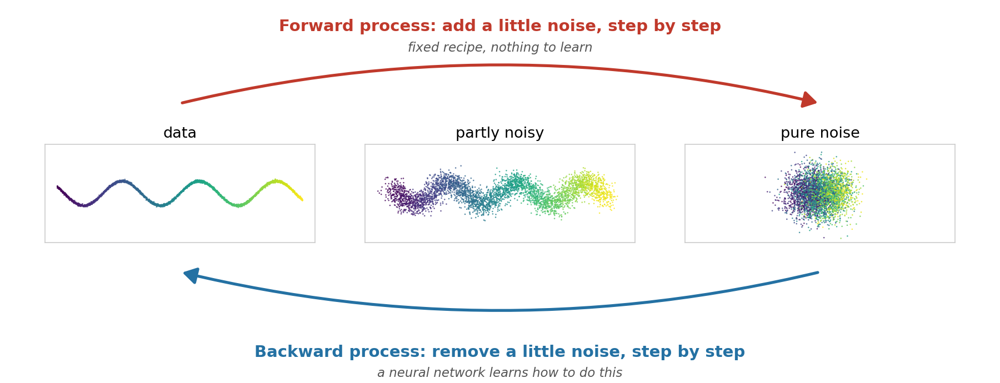
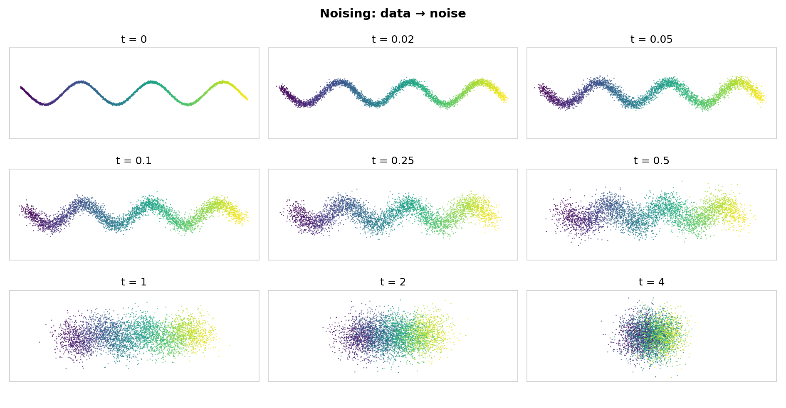
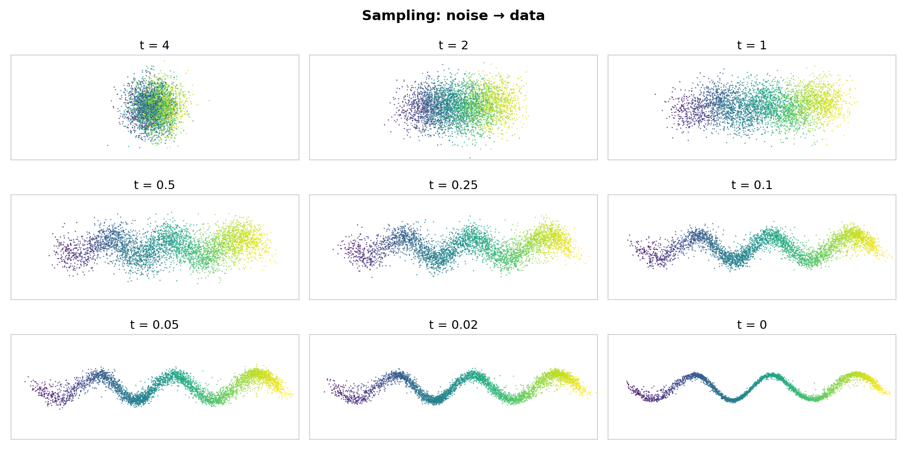

# Denoising Diffusion Probabilistic Model

**Teaching a neural network to draw a sine wave out of pure noise.**

This is a tiny diffusion model, the same idea behind modern image generators,
squeezed down to 2-D points so you can watch every step of it happen. It is
written in [JAX](https://github.com/jax-ml/jax) and trains in about 15 seconds
on a GPU.



The idea in one picture: destroying structure is easy, so we do it on purpose,
one small step at a time. A neural network then learns to reverse each small
step. Once it has, any blob of random noise can be walked back into new data.

## Forward/Noising Process

Start with points on a wiggly sine curve. Then add a little Gaussian noise,
again and again, while gently pulling everything toward the origin. The wave
blurs, then melts, and by the end it's just a shapeless blob of noise.



## Backward/Sampling Process

Now teach a small neural network to undo one tiny step of that blurring. Start
from a fresh blob of random noise, run the network backwards in time, and the
sine wave reappears from nothing.



The colours follow each point through the process. In the sampling figure, every
point was coloured by where it *ended up*, so you can see the network sorting
the noise left to right well before the curve takes shape.

## Try it yourself

```bash
pip install -e ".[notebooks]"
python scripts/make_readme_figures.py    # trains a model and redraws the figures above
```

For the full walkthrough (data, noising, training, sampling, with plots at
every stage), open [`notebooks/sine/sine.ipynb`](notebooks/sine/sine.ipynb).

## Curious how it works?

- [docs/METHOD.md](docs/METHOD.md): the math, step by step
- [docs/EXPERIMENTS.md](docs/EXPERIMENTS.md): what was tried, and what worked
- [CODEMAP.md](CODEMAP.md): a map of the code
